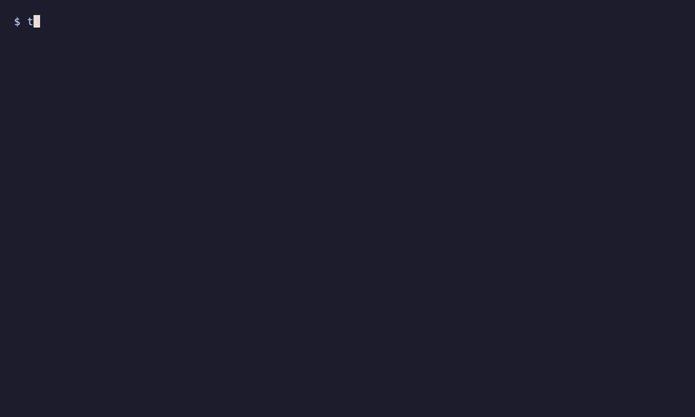

[简体中文](./README.md) · [Website](https://tooldrift.lei6393.com) · [GitHub](https://github.com/SuperMarioYL/tooldrift)

<picture>
  <source media="(max-width: 600px) and (prefers-color-scheme: dark)" srcset="./assets/presentation/hero-mobile-dark.svg">
  <source media="(max-width: 600px)" srcset="./assets/presentation/hero-mobile-light.svg">
  <source media="(prefers-color-scheme: dark)" srcset="./assets/presentation/hero-dark.svg">
  
</picture>

# ToolDrift

**See what changes in a tool-call response**

ToolDrift normalizes tool-call responses into snapshots and compares their argument shape, encoding, call count, ID format and finish reason. Use saved responses or a configured probe suite before changing an endpoint.

## Why use it

Two endpoints can accept the same request while returning arguments in different shapes. A field-level contract diff points directly to the parser or dispatcher assumption that needs review.

- **Compare concrete fields** — Arguments, emitted tools and response metadata remain separate diff entries.
- **Replay without API access** — Saved snapshots and bundled fixtures can be compared entirely offline.
- **Freeze expectations in CI** — A contract YAML can pin expected tool shapes alongside provider configuration.

## Architecture

<picture>
  <source media="(max-width: 600px) and (prefers-color-scheme: dark)" srcset="./assets/presentation/architecture-mobile-dark.svg">
  <source media="(max-width: 600px)" srcset="./assets/presentation/architecture-mobile-light.svg">
  <source media="(prefers-color-scheme: dark)" srcset="./assets/presentation/architecture-dark.svg">
  
</picture>

A YAML suite defines prompts and tool schemas. Probe loads fixture responses or calls configured chat-completion endpoints. contract.py turns each response into ToolCallShape entries within a ContractSnapshot. diff aligns tools by name and reports field changes; CLI output derives its exit code from any non-equivalence.

| Component | Responsibility |
| --- | --- |
| `Tool suite` | prompts and JSON schemas |
| `Probe / fixture` | response collection |
| `ContractSnapshot` | normalized tool-call shape |
| `ContractDiff` | per-field comparison |
| `CI report` | JSON / table / exit code |

## Install and quickstart

Python 3.12+ and uv. The default recorded scenario uses fixtures and needs no API key.

```bash
git clone https://github.com/SuperMarioYL/tooldrift.git
cd tooldrift
uv venv --python 3.12
source .venv/bin/activate
uv pip install -e .
```

The script runs the actual CLI with --from-fixtures and --format json, checks exit 1, and summarizes the field differences from the returned ContractDiff. It makes no provider calls.

```bash
.venv/bin/python examples/presentation_demo.py
```

## Recorded demo

<picture>
  <source media="(max-width: 600px) and (prefers-color-scheme: dark)" srcset="./assets/presentation/process-mobile-dark.svg">
  <source media="(max-width: 600px)" srcset="./assets/presentation/process-mobile-light.svg">
  <source media="(prefers-color-scheme: dark)" srcset="./assets/presentation/process-dark.svg">
  
</picture>

The bundled fixture pair differs in both tools; the real CLI returns the expected drift exit code 1.

```text
fixture comparison exit: 1
{"tool": "get_forecast", "differing_fields": ["arg_keys", "arg_nesting:days", "arg_nesting:include", "arg_nesting:unit", "arguments_encoding", "tool_call_id_format", "finish_reason"]}
{"tool": "get_weather", "differing_fields": ["arguments_encoding", "tool_call_id_format", "finish_reason"]}
Scope: bundled offline response fixtures; these are not current provider measurements.
```

The complete command and output are recorded in [docs/demo-results.json](./docs/demo-results.json). Inputs and reproduction code are included in the repository.



The existing recording is retained for context; the text example above documents the reproducible scenario.

## Usage

snapshot writes a reusable JSON contract. diff compares saved files offline. run supports either --old/--new or --contract with optional repeated --base selections. compare-table renders a Markdown comparison for available snapshots. Commands reporting drift intentionally return 1, including warning-class differences; command/input failures are distinct errors (exit 2), and a comparison with no tools on either side also exits 2.

```bash
.venv/bin/tooldrift snapshot --base deepseek --from-fixtures -o before.json
.venv/bin/tooldrift snapshot --base qwen --from-fixtures -o after.json
.venv/bin/tooldrift diff before.json after.json --format json
.venv/bin/tooldrift run --contract examples/contract.yaml --base deepseek --base qwen --from-fixtures --format json
```

## Configuration

contract.yaml defines version, suite, providers and optional expected tool shapes. Each provider can set base_url, model_id, api_key_env and request_quirks (merged into the request body); unknown or wrong-typed fields are rejected instead of silently ignored. Built-in aliases include deepseek, qwen, kimi, glm and minimax. Before a live run, verify endpoint/model settings and configure the named key variables; dropping --from-fixtures sends billable model requests. Fixture mode skips only providers without a bundled fixture, treats every other probe failure as an input error, and refuses incompatible model overrides rather than relabeling saved data.

## Integrations and responsibilities

<picture>
  <source media="(max-width: 600px) and (prefers-color-scheme: dark)" srcset="./assets/presentation/integrations-mobile-dark.svg">
  <source media="(max-width: 600px)" srcset="./assets/presentation/integrations-mobile-light.svg">
  <source media="(prefers-color-scheme: dark)" srcset="./assets/presentation/integrations-dark.svg">
  
</picture>

Provider aliases supply endpoint, model and key-environment defaults. The tool does not proxy application traffic or execute the model’s requested tools. Its fixtures are sample response data; their provider labels do not establish current behavior of any service.

| Route | Implemented role |
| --- | --- |
| OpenAI-compatible | configured chat-completion probes |
| Saved JSON | snapshot and response inputs |
| Contract YAML | providers and pinned expected shapes |
| JSON diff | CI-readable field changes |
| Markdown table | cross-snapshot comparison |

## Limits and next steps

- A snapshot covers the responses collected for that suite. It is not a guarantee of all future tool calls or all prompt variants.
- Field changes can be acceptable to a tolerant caller. Review the diff against your own parser and tool contract.
- The recorded example is offline fixture replay, not a live five-provider benchmark. Streaming tool-call reassembly is not implemented.

Implemented: snapshot normalization, offline diff, live non-streaming probes, contract-file regression and Markdown comparison. Future work includes streaming response assembly and broader suites. A hosted monitoring board, scheduled alerts and subscriptions are not part of this CLI.

## License and contributions

See [LICENSE](./LICENSE). When reporting an issue, include a minimal input, the command, and the observed output.
