[English](./README.en.md) · [Website](https://tooldrift.lei6393.com) · [GitHub](https://github.com/SuperMarioYL/tooldrift)

<picture>
  <source media="(max-width: 600px) and (prefers-color-scheme: dark)" srcset="./assets/presentation/hero-mobile-dark.svg">
  <source media="(max-width: 600px)" srcset="./assets/presentation/hero-mobile-light.svg">
  <source media="(prefers-color-scheme: dark)" srcset="./assets/presentation/hero-dark.svg">
  
</picture>

# ToolDrift

**看清工具调用响应的变化**

ToolDrift 将工具调用响应归一化为快照，比较参数结构、编码、调用数、ID 格式和结束原因。更换端点前，可使用已保存响应或配置好的探测集合检查差异。

## 为什么需要它

两个端点可能接受相同请求，却返回不同结构的参数。字段级契约差异能直接指出需要审阅的解析器或分发逻辑假设。

- **比较具体字段** — 参数、出现的工具和响应元数据分别列为差异项。
- **无需 API 即可回放** — 保存的快照和内置样本可完全离线比较。
- **在 CI 固定预期** — 契约 YAML 可在服务商配置旁固定预期工具结构。

## 架构

<picture>
  <source media="(max-width: 600px) and (prefers-color-scheme: dark)" srcset="./assets/presentation/architecture-mobile-dark.svg">
  <source media="(max-width: 600px)" srcset="./assets/presentation/architecture-mobile-light.svg">
  <source media="(prefers-color-scheme: dark)" srcset="./assets/presentation/architecture-dark.svg">
  
</picture>

YAML 测试集合定义提示和工具 Schema。Probe 读取样本响应，或调用已配置的 Chat Completions 端点。contract.py 将响应整理为 ContractSnapshot 中的 ToolCallShape。diff 按名称对齐工具并报告字段变化，CLI 对任意不等价差异返回相应退出码。

| 组件 | 职责 |
| --- | --- |
| `Tool suite` | prompts and JSON schemas |
| `Probe / fixture` | response collection |
| `ContractSnapshot` | normalized tool-call shape |
| `ContractDiff` | per-field comparison |
| `CI report` | JSON / table / exit code |

## 安装与快速上手

需要 Python 3.12+ 和 uv。记录场景使用样本，不需要 API Key。

```bash
git clone https://github.com/SuperMarioYL/tooldrift.git
cd tooldrift
uv venv --python 3.12
source .venv/bin/activate
uv pip install -e .
```

脚本用 --from-fixtures 和 --format json 运行实际 CLI，核对退出码 1，并汇总返回 ContractDiff 的字段差异，不调用服务商。

```bash
.venv/bin/python examples/presentation_demo.py
```

## 实际运行示例

<picture>
  <source media="(max-width: 600px) and (prefers-color-scheme: dark)" srcset="./assets/presentation/process-mobile-dark.svg">
  <source media="(max-width: 600px)" srcset="./assets/presentation/process-mobile-light.svg">
  <source media="(prefers-color-scheme: dark)" srcset="./assets/presentation/process-dark.svg">
  
</picture>

The bundled fixture pair differs in both tools; the real CLI returns the expected drift exit code 1.

```text
fixture comparison exit: 1
{"tool": "get_forecast", "differing_fields": ["arg_keys", "arg_nesting:days", "arg_nesting:include", "arg_nesting:unit", "arguments_encoding", "tool_call_id_format", "finish_reason"]}
{"tool": "get_weather", "differing_fields": ["arguments_encoding", "tool_call_id_format", "finish_reason"]}
Scope: bundled offline response fixtures; these are not current provider measurements.
```

完整命令与输出保存在 [docs/demo-results.json](./docs/demo-results.json). 输入和复现代码均随仓提供。


保留已有录制供参考；上方文字示例给出当前可复现的操作。

## 用法

snapshot 写出可复用 JSON 契约，diff 离线比较文件。run 可使用 --old/--new，或 --contract 配合可重复 --base 选择。compare-table 为可用快照生成 Markdown 比较表。报告差异的命令按预期返回 1，包括 warning 类差异；命令或输入失败属于另一类错误。

```bash
.venv/bin/tooldrift snapshot --base deepseek --from-fixtures -o before.json
.venv/bin/tooldrift snapshot --base qwen --from-fixtures -o after.json
.venv/bin/tooldrift diff before.json after.json --format json
.venv/bin/tooldrift run --contract examples/contract.yaml --base deepseek --base qwen --from-fixtures --format json
```

## 配置

contract.yaml 定义 version、suite、providers 和可选 expected 工具结构。各服务商可设置 base_url、model_id、api_key_env 和请求差异参数。内置别名包含 deepseek、qwen、kimi、glm、minimax。在线运行前需核对端点、模型及密钥变量；去掉 --from-fixtures 会发送可能计费的模型请求。样本模式拒绝不兼容模型覆盖，不会给已保存数据换标签。

## 集成与职责分工

<picture>
  <source media="(max-width: 600px) and (prefers-color-scheme: dark)" srcset="./assets/presentation/integrations-mobile-dark.svg">
  <source media="(max-width: 600px)" srcset="./assets/presentation/integrations-mobile-light.svg">
  <source media="(prefers-color-scheme: dark)" srcset="./assets/presentation/integrations-dark.svg">
  
</picture>

服务商别名提供端点、模型和密钥环境变量默认值。工具不代理业务流量，也不执行模型请求的工具。内置样本是响应示例数据，样本上的服务商标签不能代表任何服务的当前行为。

| 路径 | 已实现职责 |
| --- | --- |
| OpenAI-compatible | configured chat-completion probes |
| Saved JSON | snapshot and response inputs |
| Contract YAML | providers and pinned expected shapes |
| JSON diff | CI-readable field changes |
| Markdown table | cross-snapshot comparison |

## 限制与后续方向

- 快照仅覆盖该测试集合收集的响应，不能保证未来所有工具调用或提示变体。
- 宽容的调用方可能接受某些字段变化，应结合自身解析器和工具约定审阅差异。
- 记录示例是离线样本回放，不是五家服务商在线基准。流式工具调用重组尚未实现。

已实现快照归一化、离线差异、非流式在线探测、契约文件回归和 Markdown 比较。后续方向是流式响应组装和更广测试集合。托管监控面板、定时提醒和订阅不在当前 CLI 内。

## 许可与贡献

许可见 [LICENSE](./LICENSE). 反馈问题时请提供最小输入、执行命令和实际输出。
